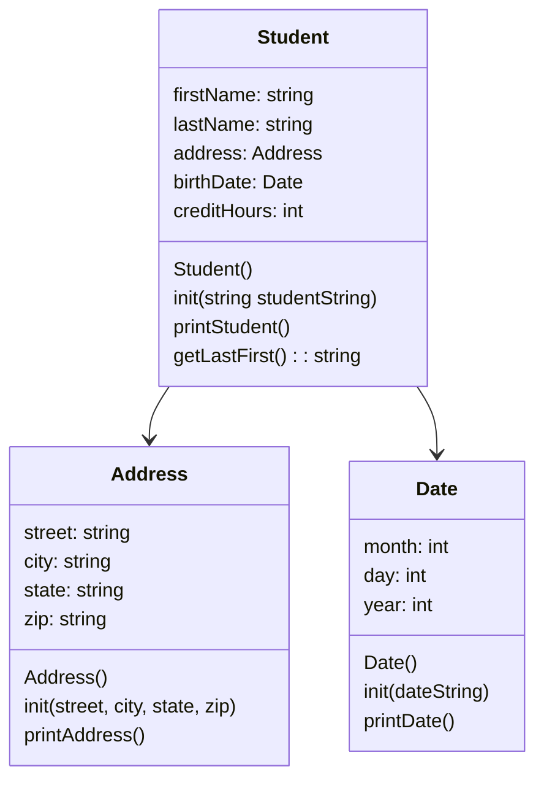

# Student Records

## Class Diagram

## loadStudents
    make an ifstream named inFile
    make a line for the current line currentLine
    in the ifstream object open students.csv
    while there are lines left to read, put the next one in currentLine
        make a new Student pointer named s
        give currentLine to the init method of s
        add s to the end of the students vector
    close the ifstream object

## printStudents
    for each student in the students vector
        print the student's data

## showStudentNames
    for each student in the students vector
        print the student's name as last, first and end the line

## findStudent
    make a string for the search text named search
    ask for the last name of the student
    read the line the user types and put it in search
    for each student in the students vector
        get the last name of the student
        if search is found in the last name (find does not return npos)
            print the student's data

## delStudents
    for each student in the students vector
        delete the student
    clear the students vector

## menu
    make a string for the user's choice named choice
    print the options 0 through 3, one per line
    ask the user to choose 0-3
    read the line the user types and put it in choice
    return choice

